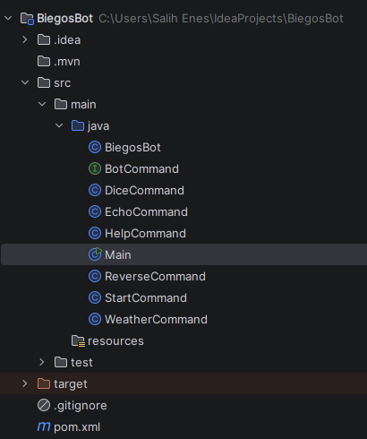
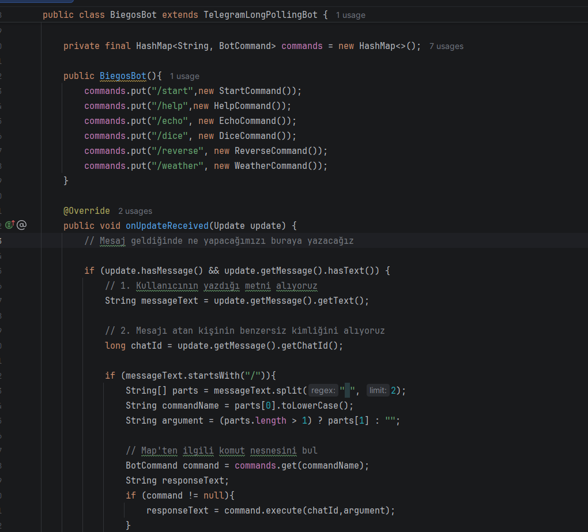
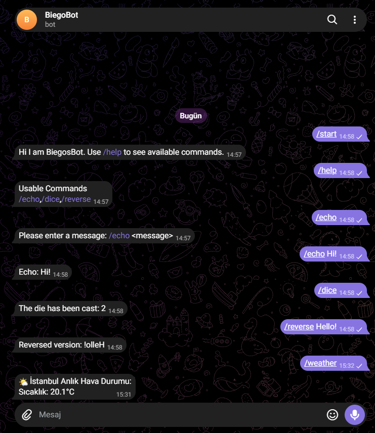

# Java Development Journey 

**Learning Java by building: a Telegram bot, REST API experiments and console applications.**

[English](#english) | [Türkçe](#türkçe)

---

<a id="english"></a>

## 🇬🇧 English

### About

I'm a Computer Engineering student. About 2–3 weeks ago I finished Bro Code's 12-hour Java course, and right after that I started applying it by building projects instead of only watching tutorials.

This repository documents that process: what I built, what I learned from it, and what I plan to improve. The projects are learning projects, not production software. The point is to show real progress, step by step.

Some days I code for 5–6 hours, and on heavier days 8–9. A few times I've stayed at the university library for a full day, working for 2–3 hours at a stretch without a break. I do this because building something that works teaches me far more than memorizing syntax.

### How I work

1. **Learn** a concept (interfaces, HTTP requests, JSON parsing...).
2. **Build** something small that uses it.
3. **Refactor** it and look for a cleaner structure.

---

### Project 1: BiegosBot (Telegram Bot)

A Telegram bot written in Java with the [TelegramBots](https://github.com/rubenlagus/TelegramBots) library (`TelegramLongPollingBot`), built with Maven in IntelliJ IDEA.

My goal was to avoid putting everything into one giant `if / else` block. Each command is its own class, and the bot only decides *which* command to run.

#### Project structure



```
BiegosBot/
├── pom.xml
└── src/main/java/
    ├── Main.java
    ├── BiegosBot.java        // receives updates and routes commands
    ├── BotCommand.java       // interface every command implements
    ├── StartCommand.java
    ├── HelpCommand.java
    ├── EchoCommand.java
    ├── DiceCommand.java
    ├── ReverseCommand.java
    └── WeatherCommand.java   // calls the Open-Meteo API
```

#### Architecture

- **`BotCommand` interface:** defines one shared contract. Every command receives the `chatId` and the user's argument and returns a response `String`.
- **One class per command:** `StartCommand`, `HelpCommand`, `EchoCommand`, `DiceCommand`, `ReverseCommand`, `WeatherCommand`.
- **Routing with `HashMap<String, BotCommand>`:** command names (like `/dice`) are mapped to command objects. Adding a new command means writing a new class and registering it in one line.

```java
private final HashMap<String, BotCommand> commands = new HashMap<>();

public BiegosBot() {
    commands.put("/start", new StartCommand());
    commands.put("/help", new HelpCommand());
    commands.put("/echo", new EchoCommand());
    commands.put("/dice", new DiceCommand());
    commands.put("/reverse", new ReverseCommand());
    commands.put("/weather", new WeatherCommand());
}
```

#### How a message is handled (`onUpdateReceived`)

1. Check that the update contains a text message.
2. If the text starts with `/`, split it into the command name and an optional argument (`split(" ", 2)`).
3. Look the command up in the `HashMap`.
4. If it exists, call `execute(chatId, argument)` and send the result back; otherwise handle it as an unknown command.



#### Demo



| Command | What it does |
|---|---|
| `/start` | Greets the user |
| `/help` | Lists the available commands |
| `/echo <message>` | Repeats the message back |
| `/dice` | Rolls a die |
| `/reverse <text>` | Reverses the given text |
| `/weather` | Shows the current temperature in Istanbul |

#### What I practiced here

- Interfaces and polymorphism (different classes, one common type)
- Separation of responsibilities
- Using a `HashMap` as a lookup table for commands
- Parsing user input
- Working with an external library and a `pom.xml` dependency setup

---

### Project 2: REST API & JSON (`WeatherCommand`)

`WeatherCommand` fetches live data from the [Open-Meteo](https://open-meteo.com/) API using Java's built-in `HttpClient`, then reads the result with `org.json`.

```java
HttpRequest request = HttpRequest.newBuilder()
        .uri(URI.create(url))
        .GET()
        .build();

HttpResponse<String> response =
        httpClient.send(request, HttpResponse.BodyHandlers.ofString());

if (response.statusCode() == 200) {
    JSONObject json = new JSONObject(response.body());
    double temperature = json.getJSONObject("current").getDouble("temperature_2m");
    // ...
}
```

**Flow:** build the request → send it → check the HTTP status code → parse the JSON → extract `current.temperature_2m` → return a readable message. Connection problems (`IOException`, `InterruptedException`) are caught and reported to the user.

**Current limitation:** the coordinates are hard-coded to Istanbul, so the command doesn't support other cities yet. Making the location dynamic (taking a city name as the argument) is on my list.

---

### Project 3: Console applications

Smaller programs I wrote to practice the fundamentals:

- **Hangman:** loops, conditions, strings
- **Slot Machine:** randomness, conditions, score tracking
- **Quiz Game:** question handling, answer checking, program flow
- **Music Player:** object-oriented design
- **Calculator and other exercises:** methods and user input

---

### 🛠️ Technologies & concepts

| Area | Used |
|---|---|
| Language | Java |
| Build tool | Maven |
| IDE | IntelliJ IDEA |
| OOP | Classes, interfaces, polymorphism |
| Collections | `HashMap` |
| Networking | `java.net.http.HttpClient`, REST, HTTP status codes |
| Data | JSON with `org.json` |
| Libraries | TelegramBots API |
| Error handling | `try / catch`, `IOException`, `InterruptedException` |
| Tools | Git, GitHub |

### ▶️ Running BiegosBot

1. Create a bot with [@BotFather](https://t.me/BotFather) on Telegram and get a token.
2. Clone the repository and open the project in IntelliJ IDEA (or use Maven).
3. Provide your own bot token where the bot is registered in `Main`.
4. Run `Main`, then open your bot in Telegram and send `/start`.

> ⚠️ Never commit your real bot token to GitHub. Keep it out of the repository (for example in an environment variable).

### 🎯 Next steps

- [ ] Make `/weather` accept a city name instead of a fixed location
- [ ] Add every command (including `/weather`) to the `/help` output
- [ ] Better input validation and error handling
- [ ] Move the bot token to an environment variable
- [ ] Add a database for persistent data
- [ ] Write unit tests for the commands
- [ ] Add more API integrations

---

<a id="türkçe"></a>

## 🇹🇷 Türkçe

### Hakkında

Bilgisayar Mühendisliği öğrencisiyim. Yaklaşık 2–3 hafta önce Bro Code'un 12 saatlik Java eğitimini bitirdim ve hemen ardından sadece izlemek yerine proje yaparak öğrendiklerimi uygulamaya başladım.

Bu depo bu süreci belgeliyor: ne yaptım, ne öğrendim ve neyi geliştirmeyi planlıyorum. Buradaki projeler üretime hazır yazılımlar değil, öğrenme projeleri. Amaç, gerçek ilerlemeyi adım adım göstermek.

Bazı günler 5–6 saat, yoğun günlerde 8–9 saat çalışıyorum. Birkaç kez üniversite kütüphanesinde bir gün boyunca kaldım, 2–3 saat mola vermeden kod yazdığım oldu. Çünkü çalışan bir şey inşa etmek, sözdizimi ezberlemekten çok daha fazla şey öğretiyor.

### Çalışma şeklim

1. Bir kavramı **öğren** (interface, HTTP istekleri, JSON ayrıştırma...).
2. Onu kullanan küçük bir şey **yap**.
3. **Yeniden düzenle**, daha temiz bir yapı ara.

---

### Proje 1: BiegosBot (Telegram Botu)

Java ile [TelegramBots](https://github.com/rubenlagus/TelegramBots) kütüphanesi (`TelegramLongPollingBot`) kullanılarak yazılmış, IntelliJ IDEA'da Maven ile geliştirilmiş bir Telegram botu.

Amacım her şeyi tek bir dev `if / else` bloğuna doldurmamaktı. Her komut kendi sınıfında, bot ise sadece *hangi* komutun çalışacağına karar veriyor.

#### Mimari

- **`BotCommand` interface'i:** ortak bir sözleşme tanımlar. Her komut `chatId` ve kullanıcının argümanını alır, cevap olarak bir `String` döndürür.
- **Her komut için ayrı sınıf:** `StartCommand`, `HelpCommand`, `EchoCommand`, `DiceCommand`, `ReverseCommand`, `WeatherCommand`.
- **`HashMap<String, BotCommand>` ile yönlendirme:** komut adları (`/dice` gibi) komut nesnelerine eşlenir. Yeni komut eklemek için yeni bir sınıf yazıp tek satırda kaydetmek yeterli.

#### Mesaj nasıl işleniyor (`onUpdateReceived`)

1. Güncellemede metin içeren bir mesaj olup olmadığı kontrol edilir.
2. Metin `/` ile başlıyorsa komut adı ve isteğe bağlı argüman ayrılır (`split(" ", 2)`).
3. Komut `HashMap` içinde aranır.
4. Bulunursa `execute(chatId, argument)` çağrılır ve sonuç gönderilir; bulunamazsa bilinmeyen komut olarak ele alınır.

#### Komutlar

| Komut | Ne yapar |
|---|---|
| `/start` | Kullanıcıyı karşılar |
| `/help` | Kullanılabilir komutları listeler |
| `/echo <mesaj>` | Mesajı geri yollar |
| `/dice` | Zar atar |
| `/reverse <metin>` | Metni ters çevirir |
| `/weather` | İstanbul'un anlık sıcaklığını gösterir |

#### Burada neler pratik ettim

- Interface ve çok biçimlilik (farklı sınıflar, ortak tip)
- Sorumlulukların ayrılması
- Komutlar için `HashMap`'i arama tablosu olarak kullanmak
- Kullanıcı girdisini ayrıştırmak
- Harici kütüphane ve `pom.xml` ile bağımlılık yönetimi

---

### Proje 2: REST API ve JSON (`WeatherCommand`)

`WeatherCommand`, Java'nın yerleşik `HttpClient` sınıfıyla [Open-Meteo](https://open-meteo.com/) API'sinden canlı veri çeker ve sonucu `org.json` ile okur.

**Akış:** istek hazırlanır → gönderilir → HTTP durum kodu kontrol edilir → JSON ayrıştırılır → `current.temperature_2m` alınır → okunabilir bir mesaj döndürülür. Bağlantı sorunları (`IOException`, `InterruptedException`) yakalanıp kullanıcıya bildirilir.

**Şu anki sınırlama:** koordinatlar İstanbul'a sabitlenmiş durumda, yani komut henüz başka şehirleri desteklemiyor. Konumu dinamik yapmak (şehir adını argüman olarak almak) yapılacaklar listemde.

---

### Proje 3: Konsol uygulamaları

Temelleri pekiştirmek için yazdığım küçük programlar:

- **Adam Asmaca:** döngüler, koşullar, metin işlemleri
- **Slot Makinesi:** rastgelelik, koşullar, skor takibi
- **Bilgi Yarışması:** soru yönetimi, cevap kontrolü, program akışı
- **Müzik Çalar:** nesne yönelimli tasarım
- **Hesap Makinesi ve diğer alıştırmalar:** metotlar ve kullanıcı girdisi

---

### Teknolojiler ve kavramlar

| Alan | Kullanılanlar |
|---|---|
| Dil | Java |
| Build aracı | Maven |
| IDE | IntelliJ IDEA |
| OOP | Sınıflar, interface, çok biçimlilik |
| Koleksiyonlar | `HashMap` |
| Ağ | `java.net.http.HttpClient`, REST, HTTP durum kodları |
| Veri | `org.json` ile JSON |
| Kütüphaneler | TelegramBots API |
| Hata yönetimi | `try / catch`, `IOException`, `InterruptedException` |
| Araçlar | Git, GitHub |

### BiegosBot'u çalıştırma

1. Telegram'da [@BotFather](https://t.me/BotFather) ile bir bot oluştur ve token al.
2. Depoyu klonla, projeyi IntelliJ IDEA'da aç (veya Maven kullan).
3. Kendi bot token'ını `Main` içinde botun kaydedildiği yere ekle.
4. `Main`'i çalıştır, Telegram'da botunu açıp `/start` yaz.

> ⚠️ Gerçek bot token'ını asla GitHub'a yükleme. Depo dışında tut (örneğin ortam değişkeni olarak).

### 🎯 Sonraki adımlar

- [ ] `/weather` komutunun şehir adı alması
- [ ] Tüm komutların (`/weather` dahil) `/help` çıktısında görünmesi
- [ ] Daha iyi girdi doğrulama ve hata yönetimi
- [ ] Bot token'ını ortam değişkenine taşımak
- [ ] Kalıcı veri için veritabanı eklemek
- [ ] Komutlar için birim testleri yazmak
- [ ] Yeni API entegrasyonları

---

**Üreterek öğren. Deneyerek geliştir. / Learning by building. Improving by experimenting.**
